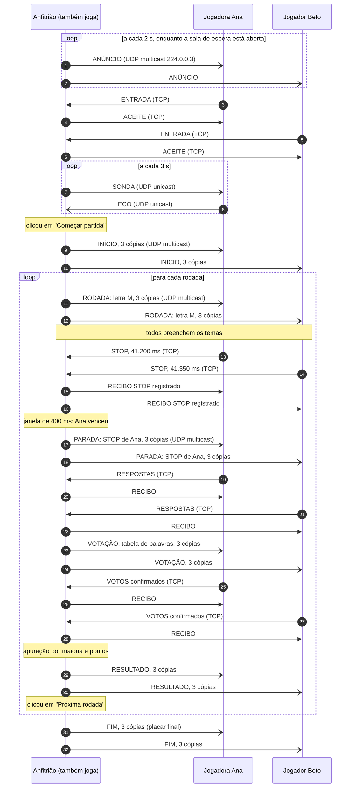
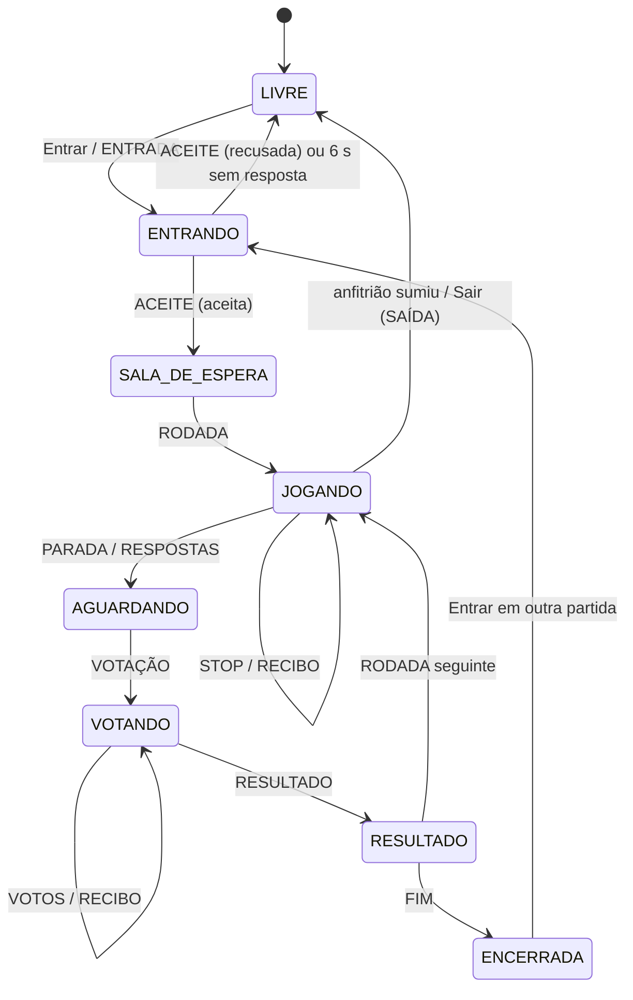

# Plugin Stop (Adedonha): protocolo STOP/1

Versão em rede do Stop (também chamado de Adedonha): a cada rodada sai uma letra, todos preenchem uma palavra para cada tema (nome, animal, cor, fruta…) e quem terminar primeiro grita **STOP!**, encerrando a rodada para todo mundo. Depois, os próprios jogadores votam nas palavras dos outros para decidir quais valem.

Quem cria a partida é o **anfitrião**, e ele também joga. Os colegas veem a partida aparecer na lista, entram e jogam juntos, sem servidor central.

O plugin não abre nenhum socket próprio: tudo passa pelo núcleo do Pitiupi (`MessageDispatcher`), que oferece UDP multicast, UDP unicast e TCP. Os pontos de rede mais interessantes do trabalho são:

- **o STOP é uma condição de corrida pela rede:** dois jogadores podem apertar quase ao mesmo tempo, e o anfitrião decide quem foi primeiro descontando o atraso de rede (RTT) de cada um;
- **a votação é distribuída:** cada jogador julga as palavras dos outros, e o resultado sai por maioria;
- **a rodada para para todos ao mesmo tempo** por multicast, com recuperação por TCP para quem perdeu os pacotes.

- [1. Como rodar e jogar](#1-como-rodar-e-jogar)
- [2. Regras do jogo](#2-regras-do-jogo)
- [3. Organização do código](#3-organização-do-código)
- [4. Visão geral do protocolo](#4-visão-geral-do-protocolo)
- [5. Formato das mensagens](#5-formato-das-mensagens)
- [6. Fluxo de uma partida](#6-fluxo-de-uma-partida)
- [7. Máquinas de estado](#7-máquinas-de-estado)
- [8. A corrida pelo STOP](#8-a-corrida-pelo-stop)
- [9. Votação distribuída](#9-votação-distribuída)
- [10. Confiabilidade](#10-confiabilidade)
- [11. Detecção de falhas](#11-detecção-de-falhas)
- [12. Segurança e limitações de confiança](#12-segurança-e-limitações-de-confiança)
- [13. Temporizadores e constantes](#13-temporizadores-e-constantes)
- [14. Observando no Wireshark](#14-observando-no-wireshark)
- [15. Testes](#15-testes)
- [16. Limitações](#16-limitações)

---

## 1. Como rodar e jogar

Este repositório tem **só o plugin**. Ele é compilado contra o núcleo do Pitiupi ([git.alice.ufsj.edu.br/fls/pitiupi](https://git.alice.ufsj.edu.br/fls/pitiupi)) e precisa ficar dentro dele, na pasta `plugins/stop`.

1. Baixe o Pitiupi e, dentro dele, este plugin na pasta `plugins/stop`:

```bash
git clone https://git.alice.ufsj.edu.br/fls/pitiupi.git
cd pitiupi
git clone https://github.com/zeroplank/pitiupi-stop.git plugins/stop
```

2. Acrescente esta entrada à lista `plugins` do arquivo `plugins.registry.json`, na raiz do Pitiupi:

```json
{
  "id": "stop",
  "dir": "plugins/stop",
  "build": "ant",
  "jar": "dist/pitiupi.stop.jar",
  "menuCategory": "Jogos"
}
```

3. Compile e abra (é preciso ter `java`, `ant` e `python3`, como pede o README do Pitiupi):

```bash
./scripts/pitiupi.sh run --all
```

O build do plugin procura o núcleo em `../../pitiupi/dist/pitiupi.jar` (propriedade `project.pitiupi` em `nbproject/project.properties`), por isso o plugin precisa estar em `plugins/stop`. Para compilar só o plugin, depois de compilar o núcleo (`cd pitiupi && ant jar`):

```bash
cd plugins/stop && ant jar              # gera dist/pitiupi.stop.jar
```

Outra opção é instalar o JAR pronto pela aba **Configurações → Instalar JAR…** do Pitiupi.

**Para jogar** (são precisos pelo menos dois computadores na mesma rede e na mesma porta; veja o arquivo `docs/rede.md` do Pitiupi):

1. Abra a aba **Stop (Adedonha)** na galeria de plugins.
2. **Anfitrião:** escolha o título, o número de rodadas, o tempo máximo por rodada e os temas. Dá para marcar temas da lista ou criar temas novos em **Novo tema**. Clique em **Abrir sala de espera**.
3. **Jogadores:** a partida aparece em até 2 s em **Partidas abertas na rede**. Selecione e clique em **Entrar na partida**.
4. O anfitrião vê quem entrou (com o RTT de cada um) e clica em **Começar partida**.
5. Sai a letra. Cada um preenche os temas; a borda do campo fica verde quando a palavra começa com a letra certa e vermelha quando não começa. Quando todos os campos estão corretos, o botão **STOP!** é liberado.
6. Alguém aperta STOP, ou o tempo acaba: os campos travam e as palavras são enviadas.
7. **Votação:** aparece a tabela com as palavras de todos. Desmarque as que você acha inválidas e clique em **Confirmar votos**.
8. **Resultado:** as palavras aparecem coloridas (verde vale 10, amarelo vale 5, vermelho vale 0) junto com o placar. O anfitrião clica em **Próxima rodada**.
9. Depois da última rodada aparece o pódio.

O painel de baixo, **Protocolo STOP/1**, mostra cada mensagem enviada (→) e recebida (←), com o transporte usado.

---

## 2. Regras do jogo

| Regra | Como funciona |
| --- | --- |
| Letra | Sorteada pelo anfitrião, sem repetir dentro da partida. K, Q, W, X e Y ficam de fora, a menos que o anfitrião marque **Incluir letras difíceis**. |
| Temas | 16 temas prontos (10 marcados por padrão), incluindo "Termo de redes", mais quantos temas novos o anfitrião quiser criar. |
| Comparação de palavras | Sem diferenciar maiúsculas, acentos e espaços extras: "São Paulo", "sao paulo" e " SAO  PAULO " são a mesma palavra. |
| Invalidação automática | Palavra em branco ou que não começa com a letra da rodada vale 0, sem votação. |
| Votação | Cada palavra começa valendo. Ela só cai se a **maioria absoluta** dos outros jogadores votar contra. Empate fica a favor de quem escreveu. Ninguém vota nas próprias palavras. |
| Pontos | **10** pela palavra válida que só você escreveu naquele tema, **5** pela palavra válida que outra pessoa também escreveu, **0** pela palavra inválida. |
| Rodada | Termina quando alguém pede STOP (precisa ter preenchido todos os temas com a letra certa) ou quando o tempo máximo acaba. |

---

## 3. Organização do código

```
plugins/stop/
├── README.md                       ← este documento
├── build.xml, nbproject/           ← build Ant (mesmo esquema dos outros plugins)
├── src/META-INF/services/pitiupi.models.Plugin   ← SPI: pitiupi.stop.plugin.StopPlugin
├── src/pitiupi/stop/
│   ├── plugin/StopPlugin.java      ← entrada do plugin; encaminha cada mensagem ao anfitrião ou ao jogador
│   ├── net/                        ← as 16 mensagens do protocolo e o PlayerScore
│   ├── control/
│   │   ├── StopHost.java           ← máquina de estados do anfitrião (rodadas, STOP, votação, placar)
│   │   ├── StopPlayer.java         ← máquina de estados do jogador (descoberta, palavras, votos)
│   │   ├── StopRules.java          ← regras: letras, comparação de palavras, pontos, maioria, RTT
│   │   ├── Link.java               ← envio com entrega local (o anfitrião também joga)
│   │   ├── Dedup.java              ← descarte de cópias (senderId, seq)
│   │   ├── StopTransport.java      ← interface de rede (permite testar sem sockets)
│   │   └── PitiupiTransport.java   ← implementação real sobre o MessageDispatcher
│   └── GUI/StopPanel.java          ← interface Swing
└── test/pitiupi/stop/StopSimulation.java   ← partida simulada com perda de pacotes
```

---

## 4. Visão geral do protocolo

### Papéis

| Papel | Quem é | Responsabilidade |
| --- | --- | --- |
| **Anfitrião** | Quem clicou em *Abrir sala de espera* | Guarda o estado oficial: jogadores, rodada, letra, palavras, votos e placar. Sorteia a letra, decide quem pediu STOP primeiro e apura a votação. **Também joga.** |
| **Jogador** | Quem entrou na partida | Preenche as palavras, pede STOP, vota e mostra o placar. |

É uma arquitetura **P2P híbrida**: qualquer participante pode ser anfitrião e a descoberta é feita por multicast, sem diretório central. Durante a partida, o anfitrião é o árbitro, o que evita um consenso distribuído sobre a ordem dos pedidos de STOP. A votação, por outro lado, é feita pelos próprios jogadores: o anfitrião só conta os votos.

### Como o anfitrião joga a própria partida

O anfitrião roda ao mesmo tempo um `StopHost` (o árbitro) e um `StopPlayer` (o jogador). As mensagens entre os dois **não passam pela rede**: o `Link` serializa a mensagem e a desserializa numa thread própria, na ordem de envio, exatamente como se tivesse vindo de um socket. Assim o anfitrião segue as mesmas regras que os outros (inclusive no STOP, em que o RTT dele é zero).

O multicast do anfitrião também é entregue localmente. As cópias que voltam pela rede (o multicast chega a quem enviou) são descartadas pelo plugin, que compara o `senderId` com o próprio id.

### Mensagens e transporte de cada uma

Os nomes em maiúsculas são os que aparecem no log da interface. Entre parênteses está a classe Java correspondente.

| Mensagem | Direção | Transporte | Por quê |
| --- | --- | --- | --- |
| `ANÚNCIO` (`AnnounceMessage`) | anfitrião → sala | **UDP multicast**, a cada 2 s | Descoberta: o anfitrião não sabe quem quer jogar. Um datagrama chega a todos; se um se perder, outro sai em 2 s (estado leve). |
| `ENTRADA` (`JoinMessage`) | jogador → anfitrião | **TCP** | Pedido de entrada; precisa chegar. |
| `ACEITE` (`JoinAckMessage`) | anfitrião → jogador | **TCP** | Aceita ou recusa, com o motivo. |
| `SAÍDA` (`LeaveMessage`) | jogador → anfitrião | **TCP** | Saída voluntária. |
| `SONDA` / `ECO` (`ProbeMessage` / `EchoMessage`) | anfitrião ↔ jogador | **UDP unicast**, a cada 3 s | Medição do RTT de cada jogador, usado para julgar a corrida pelo STOP. |
| `INÍCIO` (`StartMessage`) | anfitrião → sala | **UDP multicast**, 3 cópias | Temas, rodadas e a lista oficial de jogadores. |
| `RODADA` (`RoundMessage`) | anfitrião → sala | **UDP multicast**, 3 cópias | **A letra chega a todos no mesmo instante**, com um único envio. Com TCP, o anfitrião mandaria N cópias em sequência e o último da lista começaria depois. |
| `STOP` (`StopCallMessage`) | jogador → anfitrião | **TCP** + `RECIBO` | Pedido de parada, com o tempo medido pelo jogador. |
| `PARADA` (`HaltMessage`) | anfitrião → sala | **UDP multicast**, 3 cópias, depois **TCP** para quem não respondeu | Todos param de escrever ao mesmo tempo. |
| `RESPOSTAS` (`AnswersMessage`) | jogador → anfitrião | **TCP** + `RECIBO` | As palavras do jogador; não podem se perder. |
| `VOTAÇÃO` (`VotingMessage`) | anfitrião → sala | **UDP multicast**, 3 cópias | A tabela com as palavras de todos, a mesma para todo mundo. |
| `VOTOS` (`VotesMessage`) | jogador → anfitrião | **TCP** + `RECIBO` | O voto de cada jogador. Pode ser reenviado; vale o último. |
| `RECIBO` (`ReceiptMessage`) | anfitrião → jogador | **TCP** | Confirmação, na aplicação, de STOP, RESPOSTAS e VOTOS. |
| `RESULTADO` (`ResultMessage`) | anfitrião → sala | **UDP multicast**, 3 cópias | Veredito de cada palavra, pontos e placar. |
| `FIM` (`EndMessage`) | anfitrião → sala | **UDP multicast**, 3 cópias | Placar final ou cancelamento. |

A presença (quem está conectado) é do **núcleo**: o sinal de presença (*heartbeat*) por UDP multicast a cada 5 s. O jogo reaproveita essa informação ([§11](#11-detecção-de-falhas)).

### Camadas

```
┌────────────────────────────────────────────────────┐
│ STOP/1  (RODADA, STOP, PARADA, VOTAÇÃO, …)         │  aplicação (este plugin)
├────────────────────────────────────────────────────┤
│ Serialização Java  (Message.toByteArray)           │  apresentação (núcleo)
├──────────────────────────┬─────────────────────────┤
│ UDP  (1 datagrama =      │ TCP  (quadro: inteiro   │  transporte (núcleo)
│       1 mensagem)        │  de 4 bytes N + N bytes)│
├──────────────────────────┴─────────────────────────┤
│ IP  (unicast ou grupo multicast 224.0.0.3, TTL 1)  │  rede
└────────────────────────────────────────────────────┘
```

A porta é a mesma do login (por exemplo, 5000), para UDP e para TCP.

---

## 5. Formato das mensagens

Todas as mensagens estendem `StopMessage`, que estende `pitiupi.models.Messages.Message` (`Serializable`). Cada classe tem `serialVersionUID = 1`: se um colega estiver com uma versão incompatível do plugin, a desserialização falha, em vez de gerar uma mensagem "quase certa".

### Cabeçalho comum (`StopMessage`)

| Campo | Tipo | Significado |
| --- | --- | --- |
| `version` | int | Versão do protocolo (`1`). Mensagens de outra versão são descartadas. |
| `sessionId` | String (8 dígitos hexadecimais) | Identificador da partida, sorteado pelo anfitrião. Separa partidas simultâneas na mesma sala. |
| `senderId` | String (UUID) | `instanceId` de quem enviou, o mesmo do sinal de presença do núcleo. |
| `senderName` | String | Nome exibido. |
| `seq` | long | Número de sequência por remetente. O par `(senderId, seq)` identifica o pacote e permite descartar duplicatas. |
| `sentAtMillis` | long | Instante do envio no relógio de quem enviou (informativo). |

### Corpo de cada mensagem

| Mensagem | Campos | Observações |
| --- | --- | --- |
| `ANÚNCIO` | `title`, `themes[]`, `rounds`, `secondsPerRound`, `playerNames[]`, `open` | `open=false` avisa que a sala de espera fechou. A lista de nomes atualiza a sala de espera de quem já entrou. |
| `ENTRADA` | (nenhum) | O cabeçalho já informa quem é. |
| `ACEITE` | `accepted`, `reason` | Motivos de recusa: a partida já começou ou a sala está cheia (20 jogadores). |
| `SAÍDA` | (nenhum) | |
| `SONDA` / `ECO` | `probeId` | O `ECO` devolve o `probeId` da `SONDA`. |
| `INÍCIO` | `themes[]`, `rounds`, `secondsPerRound`, `playerIds[]`, `playerNames[]` | Lista oficial de quem joga. |
| `RODADA` | `round`, `totalRounds`, `letter`, `themes[]`, `timeLimitMillis` | A letra só é revelada aqui. |
| `STOP` | `round`, `elapsedMillis` | Tempo entre a chegada da `RODADA` e o clique, no relógio do jogador ([§8](#8-a-corrida-pelo-stop)). |
| `PARADA` | `round`, `reason`, `stopperId`, `stopperName` | `reason`: `STOP` (alguém pediu), `TIME_UP` (tempo esgotado) ou `CANCELLED`. |
| `RESPOSTAS` | `round`, `words[]` | Uma palavra por tema, na ordem dos temas. O anfitrião corta palavras com mais de 60 caracteres. |
| `VOTAÇÃO` | `round`, `letter`, `themes[]`, `playerIds[]`, `playerNames[]`, `words[jogador][tema]`, `autoInvalid[jogador][tema]`, `voteTimeMillis` | `autoInvalid` marca as palavras em branco ou com outra letra. |
| `VOTOS` | `round`, `invalid[jogador][tema]`, `confirmed` | `true` onde quem vota considera a palavra inválida. `confirmed` indica que o jogador terminou de votar. |
| `RECIBO` | `kind`, `round`, `status` | `kind`: `STOP`, `RESPOSTAS` ou `VOTOS`. `status`: `ACCEPTED` (registrado), `DUPLICATE` (já registrado antes), `LATE` (fora do prazo), `NOT_IN_GAME`, `WRONG_ROUND`. |
| `RESULTADO` | `round`, `totalRounds`, `letter`, `themes[]`, `playerIds[]`, `playerNames[]`, `words[][]`, `valid[][]`, `points[][]`, `invalidVotes[][]`, `voters[]`, `ranking[]` | `voters[j]` é quantos jogadores podiam julgar as palavras do jogador `j` (todos os que votaram, menos ele). |
| `FIM` | `cancelled`, `ranking[]` | Placar final. |

`PlayerScore` (linha do placar): `playerId`, `name`, `total`, `roundPoints`, `rttMillis` (−1 = sem medida), `online`.

---

## 6. Fluxo de uma partida



O anfitrião também manda as próprias `RESPOSTAS` e `VOTOS`, mas pela entrega local, sem passar pela rede.

---

## 7. Máquinas de estado

### Anfitrião

```mermaid
stateDiagram-v2
    [*] --> SALA_DE_ESPERA: Abrir sala de espera
    SALA_DE_ESPERA --> CONTAGEM: Começar (pelo menos 2 jogadores) / INÍCIO ×3
    CONTAGEM --> RODADA: 3 s / RODADA ×3
    RODADA --> RODADA: STOP / RECIBO (janela de 400 ms)
    RODADA --> COLETA: fim da janela ou tempo esgotado / PARADA ×3
    COLETA --> COLETA: RESPOSTAS / RECIBO; 1,5 s / PARADA por TCP a quem falta
    COLETA --> VOTAÇÃO: todos responderam ou 5 s / VOTAÇÃO ×3
    VOTAÇÃO --> VOTAÇÃO: VOTOS / RECIBO
    VOTAÇÃO --> RESULTADO: todos confirmaram, prazo ou "Encerrar votação" / RESULTADO ×3
    RESULTADO --> RODADA: "Próxima rodada" / RODADA ×3
    RESULTADO --> ENCERRADA: "Ver placar final" / FIM ×3
    SALA_DE_ESPERA --> ENCERRADA: Cancelar / FIM ×3
    RODADA --> ENCERRADA: Cancelar / FIM ×3
    VOTAÇÃO --> ENCERRADA: Cancelar / FIM ×3
    ENCERRADA --> [*]
```



No código: `LOBBY`, `COUNTDOWN`, `PLAYING`, `COLLECTING`, `VOTING`, `RESULT` e `FINISHED` (enum `StopHost.State`).

### Jogador



No código: `IDLE`, `JOINING`, `LOBBY`, `PLAYING`, `WAITING`, `VOTING`, `RESULT` e `FINISHED` (enum `StopPlayer.State`).

### Mensagens fora de hora

| Situação | Tratamento |
| --- | --- |
| Cópia repetida (mesmo `senderId` e `seq`) | Descartada pelo `Dedup`. |
| `RODADA` com número menor ou igual ao atual | Ignorada (cópia atrasada). |
| `RODADA` chegando antes do `INÍCIO` | O jogador entra no jogo assim mesmo. |
| `PARADA` de uma rodada cuja `RODADA` se perdeu | O jogador não viu a letra: envia as palavras em branco e segue para a votação. |
| `VOTAÇÃO` sem ter visto a `PARADA` | O jogador trava os campos e vota normalmente. |
| `STOP` depois da `PARADA` | `RECIBO` com `LATE`: outra pessoa pediu antes. |
| `RESPOSTAS` depois de aberta a votação | `RECIBO` com `LATE`; as palavras do jogador ficam em branco. |
| `RESPOSTAS` ou `STOP` repetidos | `RECIBO` com `DUPLICATE`; nada é contado duas vezes. |
| `VOTOS` com tamanho de tabela diferente | Recusados (`WRONG_ROUND`). |
| `ENTRADA` depois do `INÍCIO` | `ACEITE` recusado: "A partida já começou." |
| Mensagem de outra `sessionId` ou `version` diferente de 1 | Descartada. |

---

## 8. A corrida pelo STOP

Este é o ponto mais interessante do protocolo. Dois jogadores terminam quase juntos e apertam STOP com 150 ms de diferença. Quem ganha?

**Se o anfitrião usasse a ordem de chegada**, ganharia quem tem a rede mais rápida, não quem terminou primeiro: um jogador no Wi-Fi com 80 ms de RTT perderia para um no cabo com 2 ms, mesmo tendo apertado antes.

**A solução tem quatro partes:**

1. **A letra sai por multicast.** Um único datagrama chega a todos praticamente no mesmo instante, então todos começam juntos.
2. **O jogador mede o próprio tempo.** `elapsedMillis` = instante do clique menos o instante em que a `RODADA` chegou, no relógio local. Esse intervalo não inclui o atraso de rede e não exige relógios sincronizados (é uma diferença no mesmo relógio).
3. **Janela de disputa.** Ao receber o primeiro `STOP`, o anfitrião não decide na hora: espera **400 ms** para receber pedidos quase simultâneos que ainda estão a caminho. Fechada a janela, vence o menor tempo.
4. **Conferência do tempo informado.** O anfitrião mede `hostObserved` = chegada do `STOP` menos envio da `RODADA`, que inclui a ida da letra e a volta do pedido, ou seja, cerca de 1 RTT a mais. O tempo informado só é aceito se estiver no intervalo plausível:

```
hostObserved − RTT − 300 ms   ≤   elapsedMillis   ≤   hostObserved + 300 ms
```

Fora do intervalo (por exemplo, alguém alterou o programa para dizer que apertou em 0 ms), o anfitrião usa a própria estimativa: `hostObserved − RTT`.

O RTT de cada jogador é medido continuamente com `SONDA`/`ECO` e suavizado como no TCP (Kurose, seção 3.5.3):

```
EstimatedRTT = (1 − α) · EstimatedRTT + α · SampleRTT,    α = 0,125
```

O log mostra a disputa: "Primeiro STOP recebido (Ana). Aguardando 400 ms…", "Outro STOP dentro da janela: Beto", "STOP disputado por 2 jogadores; venceu Ana com 41.200 ms".

---

## 9. Votação distribuída

Validar palavras automaticamente exigiria um dicionário de cada tema (e "Termo de redes" ou um tema criado na hora não teriam dicionário). Por isso a decisão é dos próprios jogadores, como no Stop de papel.

1. Depois da `PARADA`, o anfitrião junta as palavras de todos e marca como **inválidas automaticamente** as que estão em branco ou não começam com a letra.
2. A `VOTAÇÃO` leva a tabela completa para todos por multicast.
3. Cada jogador desmarca as palavras que considera inválidas e envia os `VOTOS` por TCP. Pode mudar de ideia e reenviar (vale o último envio). Se o prazo estiver acabando e o jogador não tiver confirmado, a interface envia sozinha o que estiver marcado.
4. A votação fecha quando todos os jogadores conectados confirmam, quando o prazo de 90 s acaba ou quando o anfitrião clica em **Encerrar votação**.
5. **Apuração:** para cada palavra do jogador `j`, contam os votos de todos os que votaram, **menos o próprio `j`**. A palavra cai só se mais da metade desses votantes a marcou como inválida:

```
válida  ⇔  votosContra × 2 ≤ votantes
```

Empate mantém a palavra (benefício da dúvida). Se ninguém votou, todas as palavras que passaram na checagem automática valem.

6. **Pontos por tema:** entre as palavras válidas, as que aparecem uma única vez (comparando sem acentos nem maiúsculas) valem 10; as repetidas valem 5 para cada um que a escreveu.

O `RESULTADO` mostra, para cada palavra, quantos votaram contra e quantos podiam votar (passe o mouse sobre a célula).

---

## 10. Confiabilidade

### 10.1 Multicast com redundância

`INÍCIO`, `RODADA`, `PARADA`, `VOTAÇÃO`, `RESULTADO` e `FIM` são enviados **3 vezes, com 120 ms de intervalo e o mesmo `seq`**. O receptor processa a primeira cópia e descarta as outras (`Dedup`). Com perda independente `p` por datagrama, a chance de perder as três é `p³` (0,1% para `p = 10%`). O intervalo evita que uma única rajada de perda leve as três.

Por que não usar confirmação negativa (NACK)? Com N jogadores, um NACK de cada causaria uma "implosão de NACKs" no anfitrião, o problema clássico do multicast confiável. A repetição é simples e custa pouco (a `VOTAÇÃO` com 10 jogadores e 12 temas tem poucos KB).

### 10.2 Recuperação por TCP na PARADA

A `PARADA` é a mensagem mais crítica: quem não a receber continua escrevendo e não envia as palavras. Por isso, **1,5 s depois** do multicast, o anfitrião envia a `PARADA` de novo, **por TCP**, só para quem ainda não mandou `RESPOSTAS`. É um esquema misto: multicast para o caso comum (rápido e justo) e unicast confiável só para os poucos que perderam o pacote.

Os demais casos de perda também são cobertos:
- `RODADA` perdida: o jogador recebe a `PARADA` de uma rodada que não viu e envia as palavras em branco.
- `VOTAÇÃO` perdida: o jogador simplesmente não vota; a apuração usa os votos de quem votou.
- `RESULTADO` perdido: o próximo `RESULTADO` traz o placar acumulado completo, porque o estado vem sempre inteiro, nunca como diferença.
- `FIM` perdido: o jogador percebe que o anfitrião saiu ([§11](#11-detecção-de-falhas)).

### 10.3 TCP com confirmação na aplicação

`STOP`, `RESPOSTAS` e `VOTOS` vão por TCP, mas **o TCP confirmar a entrega ao socket não garante que o anfitrião registrou a mensagem** (a conexão pode cair, a fase pode ter mudado). Por isso cada uma delas recebe um `RECIBO`: é o argumento fim a fim (*end-to-end*) de Saltzer, Reed e Clark.

- O jogador envia e liga um temporizador de **2,5 s**. Sem `RECIBO`, reenvia (até 3 tentativas), como no pare e espere (rdt 3.0, Kurose cap. 3).
- Cada tentativa é um pacote novo. O anfitrião reconhece a repetição pela rodada e responde `DUPLICATE` sem contar nada duas vezes: as operações são **idempotentes**.
- Os `VOTOS` podem ser reenviados de propósito (o jogador mudou de ideia); nesse caso o novo envio cancela as tentativas pendentes do anterior.

### 10.4 Estado leve no anúncio

A lista de partidas abertas é estado leve (*soft state*): cada `ANÚNCIO` renova a entrada, e uma entrada sem renovação há 7 s some. Se o anfitrião travar, a partida desaparece sozinha da lista dos colegas.

---

## 11. Detecção de falhas

O jogo **não cria um sinal de presença próprio**: consulta a lista de presença do núcleo, alimentada pelo *heartbeat* UDP multicast a cada 5 s, que expira em cerca de 15 s.

| Quem caiu | Quem percebe | Como | Efeito |
| --- | --- | --- | --- |
| Jogador (na sala de espera) | Anfitrião | Some da lista de presença (verificação a cada 2 s) | Sai da sala de espera. |
| Jogador (durante o jogo) | Anfitrião | Some da lista de presença | Fica marcado como desconectado e deixa de contar para "todos responderam" e "todos votaram". As palavras que ele não enviou ficam em branco. Se voltar, volta a contar. |
| Jogador sai pelo botão | Anfitrião | `SAÍDA` (TCP) | Igual ao caso anterior, sem esperar os 15 s. |
| Anfitrião | Jogadores | O `senderId` do anfitrião some da lista de presença | A partida é encerrada com o aviso de conexão perdida. |
| Anfitrião cancela ou fecha a aba | Jogadores | `FIM` com `cancelled=true` | Encerramento imediato. |

O IP de cada participante vem da lista de presença (`instanceId → InetAddress`), e não de um campo da mensagem, que poderia estar errado em máquinas com várias placas de rede.

---

## 12. Segurança e limitações de confiança

- **A letra só sai na `RODADA`.** Ninguém sabe a letra antes, nem capturando o tráfego.
- **O anfitrião é o árbitro da ordem dos STOPs** e confere o tempo informado contra o RTT medido ([§8](#8-a-corrida-pelo-stop)).
- **Ninguém vota nas próprias palavras**, e a palavra só cai por maioria absoluta dos outros.
- **Pedidos repetidos não contam duas vezes** (idempotência).

O que o protocolo **não** protege:
- Não há criptografia nem autenticação: qualquer um na rede local pode ler os pacotes ou se passar por outro `senderId`.
- O anfitrião também joga e sorteia a letra; um anfitrião com o programa alterado poderia saber a letra antes. Uma solução seria um sorteio conjunto com compromisso (cada um envia o hash de um número secreto, depois revela, e a letra sai da soma), que fica como melhoria futura.
- Uma maioria combinada pode derrubar palavras corretas: a votação resolve divergências honestas, não conluio.

---

## 13. Temporizadores e constantes

| Constante | Valor | Onde | Função |
| --- | --- | --- | --- |
| `ANNOUNCE_EVERY` | 2 s | `StopHost` | Intervalo entre os `ANÚNCIO`s. |
| `LOBBY_EXPIRY` | 7 s | `StopPlayer` | Tempo sem `ANÚNCIO` até a partida sumir da lista. |
| `JOIN_TIMEOUT` | 6 s | `StopPlayer` | Espera pelo `ACEITE`; cobre os 5 s do `connect` TCP do núcleo. |
| `PING_EVERY` | 3 s | `StopHost` | Intervalo entre as `SONDA`s de RTT. |
| α do RTT | 0,125 | `StopRules` | Peso da amostra nova (igual ao TCP). |
| `COUNTDOWN` | 3 s | `StopHost` | Entre o `INÍCIO` e a primeira `RODADA`. |
| tempo da rodada | 30 a 300 s (padrão 120 s) | escolhido pelo anfitrião | Prazo para pedir STOP. |
| `ROUND_GRACE` | 1 s | `StopHost` | Folga depois do prazo da rodada e da votação. |
| `STOP_WINDOW` | 400 ms | `StopHost` | Janela para pedidos de STOP quase simultâneos. |
| `TOLERANCE_MILLIS` | 300 ms | `StopRules` | Tolerância na conferência do tempo informado. |
| `HALT_TCP_FALLBACK` | 1,5 s | `StopHost` | Quando a `PARADA` é reenviada por TCP a quem não respondeu. |
| `ANSWER_DEADLINE` | 5 s | `StopHost` | Prazo para as `RESPOSTAS` depois da `PARADA`. |
| `VOTE_TIME` | 90 s | `StopHost` | Prazo da votação. |
| `RECEIPT_TIMEOUT` | 2,5 s | `StopPlayer` | Espera pelo `RECIBO` antes de reenviar. |
| `MAX_TRIES` | 3 | `StopPlayer` | Tentativas de envio de `STOP`, `RESPOSTAS` e `VOTOS`. |
| `MULTICAST_COPIES` | 3 | `StopHost` | Cópias das mensagens multicast importantes. |
| `COPY_SPACING` | 120 ms | `StopHost` | Intervalo entre as cópias. |
| `PRESENCE_CHECK_EVERY` | 2 s | `StopHost`, `StopPlayer` | Consulta à lista de presença do núcleo. |
| `MAX_PLAYERS` | 20 | `StopHost` | Tamanho máximo da sala. |

---

## 14. Observando no Wireshark

Com a porta 5000:

| Filtro | O que mostra |
| --- | --- |
| `ip.dst == 224.0.0.3 && udp.port == 5000` | Sinais de presença do núcleo e as mensagens `ANÚNCIO`, `INÍCIO`, `RODADA`, `PARADA`, `VOTAÇÃO`, `RESULTADO` e `FIM` (repare nas 3 cópias seguidas). |
| `udp.port == 5000 && !(ip.dst == 224.0.0.3)` | `SONDA` e `ECO` por UDP unicast. |
| `tcp.port == 5000` | `ENTRADA`, `STOP`, `RESPOSTAS`, `VOTOS` e os `RECIBO`s, além da `PARADA` de recuperação. |

O conteúdo do pacote é a serialização Java (começa com os bytes `AC ED 00 05`), e dá para ler o nome da classe, como `pitiupi.stop.net.RoundMessage`, e as palavras digitadas.

---

## 15. Testes

`test/pitiupi/stop/StopSimulation.java` roda uma partida completa **sem interface e sem sockets**: o anfitrião (que também joga) e dois jogadores trocam as mensagens reais, serializadas em `byte[]`, por uma rede em memória com atraso aleatório e **30% de perda nos datagramas UDP**. O teste confere:

- as regras: comparação sem acentos, letra inicial, invalidação automática, pontos 10/5/0, maioria absoluta e sorteio de 21 letras sem repetir;
- que os jogadores descobrem a partida e entram;
- que, com Ana pedindo STOP aos 300 ms e Beto aos 320 ms, **Ana vence a disputa** nas duas rodadas;
- que a palavra repetida (escrita com outra caixa e espaço extra) vale 5 para os dois, a palavra com outra letra é invalidada automaticamente e a palavra derrubada por 2 de 2 votos vale 0;
- que as palavras do anfitrião contam normalmente e que o placar final chega a todos (Ana 60, anfitrião 50, Beto 10).

Para rodar, na raiz do Pitiupi (depois de compilar o núcleo e o plugin):

```bash
javac -cp pitiupi/dist/pitiupi.jar:plugins/stop/dist/pitiupi.stop.jar -d /tmp/stoptest \
      plugins/stop/test/pitiupi/stop/StopSimulation.java
java  -cp pitiupi/dist/pitiupi.jar:plugins/stop/dist/pitiupi.stop.jar:/tmp/stoptest \
      pitiupi.stop.StopSimulation
```

---

## 16. Limitações

- **Um único anfitrião:** se ele cair, a partida acaba. Não há eleição de um novo anfitrião nem replicação do estado.
- **Alcance local:** o multicast usa `224.0.0.3` com TTL 1, então só funciona na mesma sub-rede, como o resto do Pitiupi.
- **Sorteio da letra pelo anfitrião**, sem sorteio conjunto ([§12](#12-segurança-e-limitações-de-confiança)).
- **Sem criptografia nem autenticação.**
- **Mesma versão do plugin:** todos precisam da mesma versão das classes de mensagem (`serialVersionUID`).
